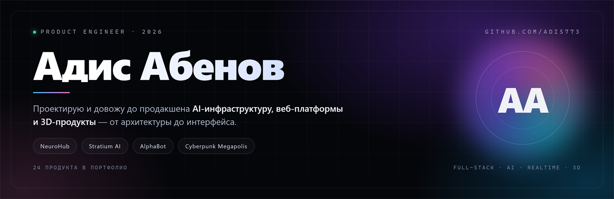
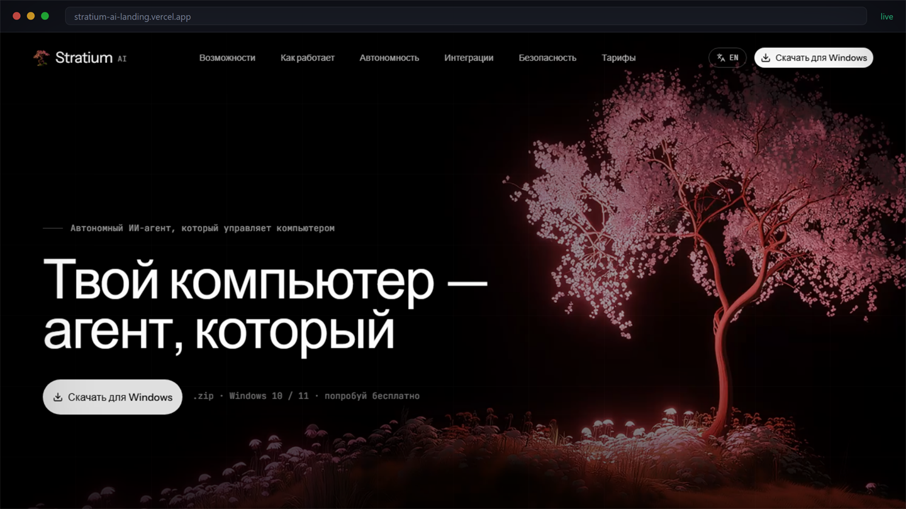
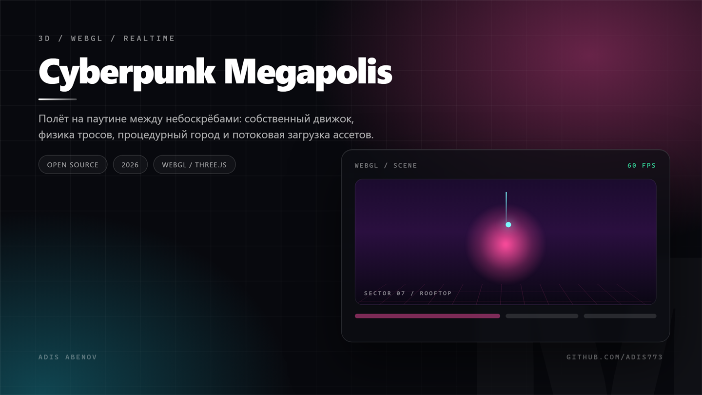
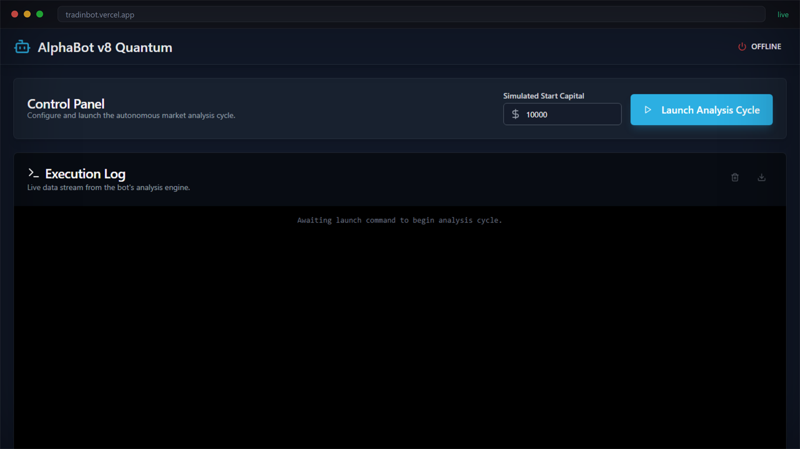
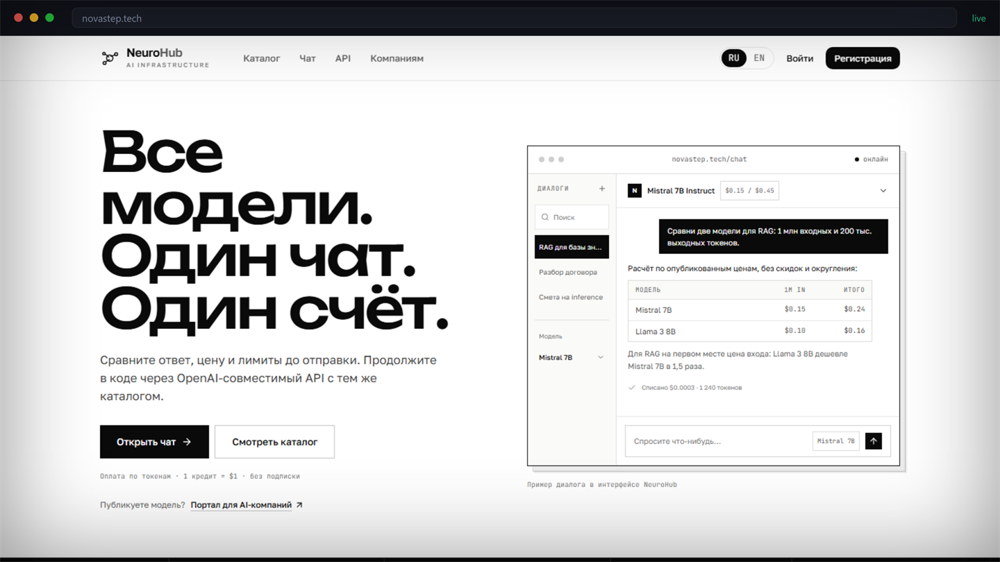
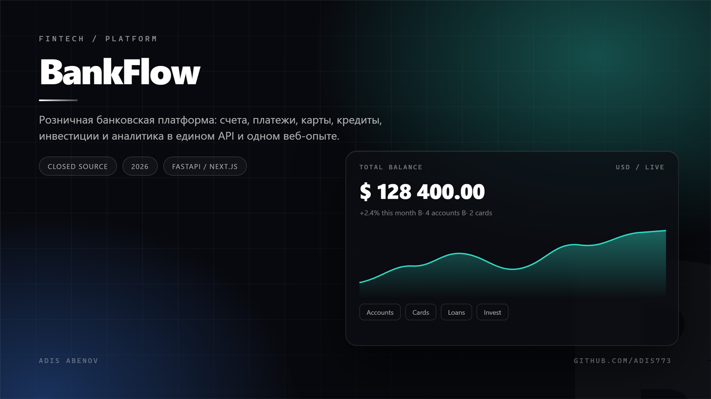
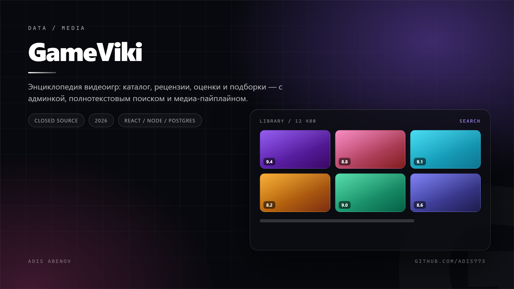

  

 

  
  
  

<h3 align="center">I build products end to end — architecture, backend, interface, deploy</h3>

  <em>AI infrastructure · web platforms · realtime &amp; 3D · 24 products shipped</em>

---

## In short

I'm **Adis Abenov**, a product engineer. I take an idea and carry it to "it works for real users": architecture, backend, frontend, model inference, payments, deployment and monitoring.

Two years in: **35 repositories with commits and 24 launched products** — from an AI model marketplace billed per token to a 3D browser game and a retail banking platform. Some code is closed by NDA or commercial confidentiality; in those cases I show the product and explain the engineering decisions, not the source.

> **Principle:** a working user journey first, beautiful architecture second. A product without users is just a folder of files.

---

## Selected work

### Stratium AI — an autonomous agent for Windows

  

An agent that operates a computer: plans tasks, works with apps and files, keeps context between sessions and can run autonomously for up to 10 days. I built the whole product — positioning, landing page, design system, copy, interactive demo and the Windows build.

**Stack:** TypeScript, React, Vite, hand-written CSS/Canvas animation
**Hard part:** explaining "an agent on your computer" without hand-waving — through scenarios, not feature lists

  
  
  

### Cyberpunk Megapolis — a 3D game in the browser

  

Web-swinging between skyscrapers: custom rope physics, procedural city, dynamic lighting and streaming of models and textures. The asset pipeline is a point of pride too — a PBR character with normals and metalness that doesn't wreck performance.

**Stack:** JavaScript, Three.js/WebGL, GLSL shaders, custom asset loader
**Hard part:** holding 60 FPS on weak laptops — polygon budget, batching, lazy sector loading

  
  
  

### AlphaBot Quantum — control room for a trading agent

  

A control panel for a trading agent: starting capital, analysis cycles, a live event stream, log export. The goal was not "another dashboard" but transparency — every decision step and every trade is visible.

**Stack:** TypeScript, React, realtime event stream, Firebase
**Hard part:** making the agent's reasoning legible enough for a trader to trust it

  
  

---

## Closed products

> Source code here is private: NDA, commercial development or pre-release. I'm happy to demo the product and walk through the architecture on a call.

### NeuroHub — AI model infrastructure

  

A platform where authors upload model weights and inference runs on first-party GPUs: a catalog with per-million-token pricing, a web chat billed by usage, an OpenAI-compatible API and one invoice across all models. The flagship: billing, inference orchestration, response streaming, multi-tenancy.

**Role:** architecture, backend, frontend, infrastructure
**Status:** in private development, demo on request

  
  

### BankFlow — retail digital banking

  

A modular monolith on FastAPI plus a Next.js customer app: accounts, transfers, cards, lending, budgets and goals, investments, analytics. Plus extraction of high-traffic domains into services behind an API gateway and Kubernetes manifests.

**Stack:** Python/FastAPI, Next.js, PostgreSQL, Kubernetes
**Status:** commercial work, source closed

### GameViki — a video game encyclopedia

  

A game catalog with reviews, ratings and collections: an editorial admin, full-text search, a media pipeline and moderation. A content product, not "one more site with cards".

**Stack:** React, Node.js, PostgreSQL, Redis
**Status:** private development

---

## Also in progress

| Project | What it is | Status |
| :-- | :-- | :-- |
| **Easgik** | Customer portal for a land-survey and cadastre service: requests, documents, account area | Commercial client, [demo](https://v0-easgikcabinet-l5.vercel.app) |
| **SmartLearnix** | AI learning platform with personal tracks, gamification and analytics | [Open source](https://github.com/Adis773/SmartLearnix) |
| **ABEBA Bank** | Zero-fee meme bank — a product experiment in brand and virality | [Open source](https://github.com/Adis773/Abeba-bank-) |
| **TgClone** | React messenger client: chats, media, realtime updates | [Open source](https://github.com/Adis773/Tgclone) |
| **freeGPT** | A zero-setup interface to language models | [Open source](https://github.com/Adis773/freeGPT) |
| **AirOS** | A browser "operating system": windows, files, apps | [Open source](https://github.com/Adis773/AirOs) |

---

## Stack

  
  
  
  
  
  
  
  
  
  

I also handle everything around the code: product decisions, interface design, copy, analytics, deployment and production support.

---

## GitHub in numbers

  
  

---

## How I work

| Step | What happens |
| :--: | :-- |
| **01** | I turn the task into a user journey: who, why, what the outcome must be |
| **02** | I build the skeleton: data model, API, key screens — validated on real data, not mockups |
| **03** | I ship it: tests on critical paths, logs, metrics, error handling, deploy |
| **04** | I stay after release: iterations, handover of code and documentation |

---

### Have something that needs to become a working product?

Write to me — you'll get a solution, not an hourly-rate quote.

Open to ambitious projects · 2026

