

  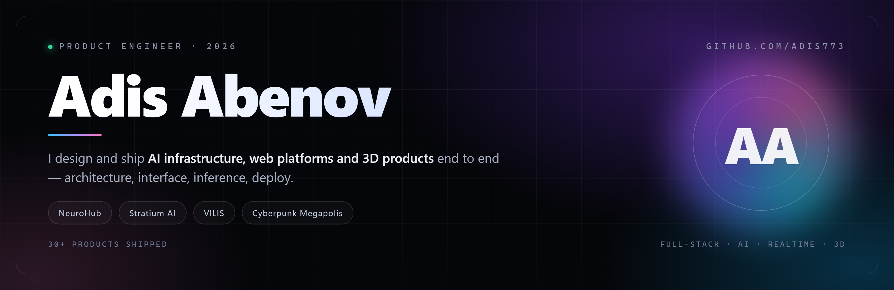

  <b>EN</b> · <a href="README.ru.md">RU</a>

  
  
  
  

<h3 align="center">I build products end to end — architecture, backend, interface, inference, deploy</h3>

<em>AI infrastructure · web platforms · realtime &amp; 3D · 30+ launches</em>

---

## Hey, I'm Adis

I'm a product engineer. I take an idea and carry it to "it works for real users": I design the architecture, write the backend and the frontend, wire up model inference, payments and monitoring, then keep it alive in production.

**30+ shipped products in two years** — an AI model marketplace billed per token, an autonomous Windows agent, a 3D browser game, an AR building tool, a retail banking platform, client portals and brand sites. Some source code is closed by NDA or commercial confidentiality: there I show the product and explain the engineering decisions, not the code itself.

> **Principle:** a working user journey first, beautiful architecture second. A product without users is just a folder of files.

  <a href="https://adis-portfolio.vercel.app"><b>→ Full portfolio site</b></a>

---

## Featured launches

### NeuroHub — AI model infrastructure

  <a href="https://novastep.tech">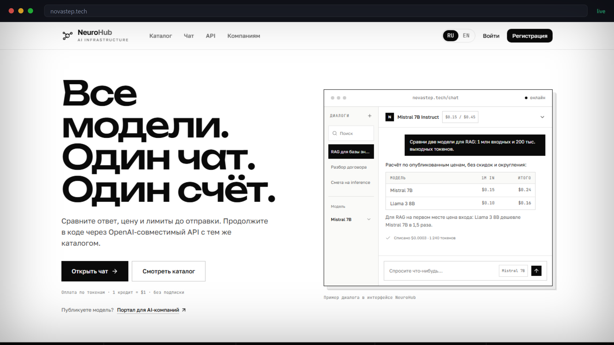</a>

A marketplace where authors upload model weights and inference runs on first-party GPUs: a catalog with per-million-token pricing, a web chat billed by actual usage, an OpenAI-compatible API and one invoice across every model. Billing, inference orchestration, response streaming, multi-tenancy — all built from scratch.

**Role:** architecture, backend, frontend, infrastructure
**Status:** live, closed source — demo on request

  
  

### Stratium AI — an autonomous agent for Windows

  <a href="https://stratium-ai-landing.vercel.app">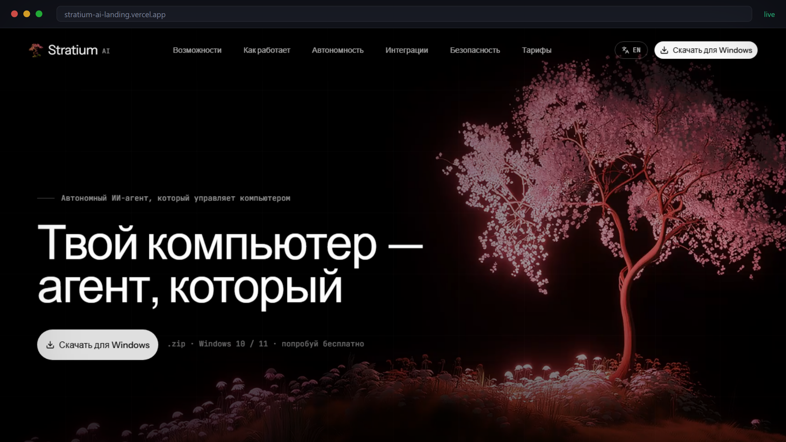</a>

An agent that operates a computer: plans tasks, works with apps and files, keeps context between sessions and runs autonomously for up to 10 days. I built the whole product — positioning, landing page, design system, copy, interactive demo and the Windows build.

**Stack:** TypeScript, React, Vite, hand-written CSS/Canvas animation
**Hard part:** explaining "an agent on your computer" without hand-waving — through scenarios, not feature lists

  
  
  

### Cyberpunk Megapolis — a 3D game in the browser

  <a href="https://cyberpunk-megapolis.vercel.app">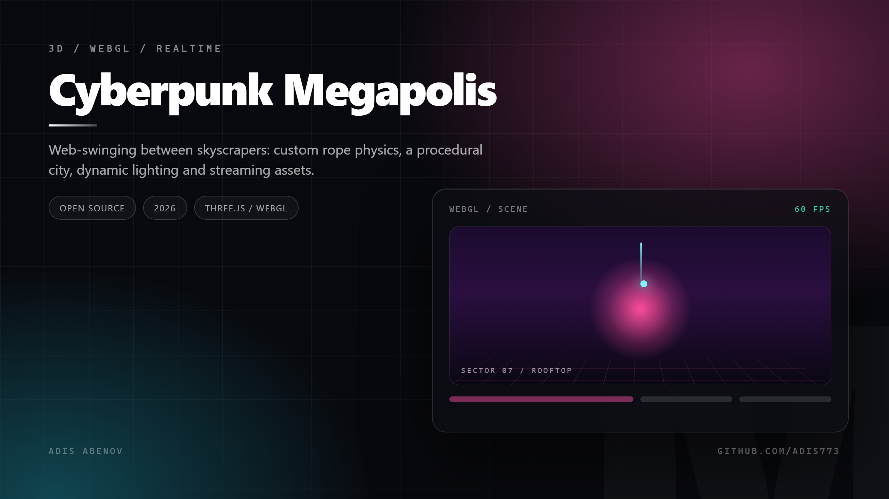</a>

Web-swinging between skyscrapers: custom rope physics, a procedural city, dynamic lighting and streaming of models and textures. The asset pipeline is a point of pride too — a PBR character with normals and metalness that doesn't wreck performance.

**Stack:** JavaScript, Three.js/WebGL, GLSL shaders, custom asset loader
**Hard part:** holding 60 FPS on weak laptops — polygon budget, batching, lazy sector loading

  
  
  

---

## More launches

<table>
<tr>
<td width="50%" valign="top">
  <a href="https://tradinbot.vercel.app">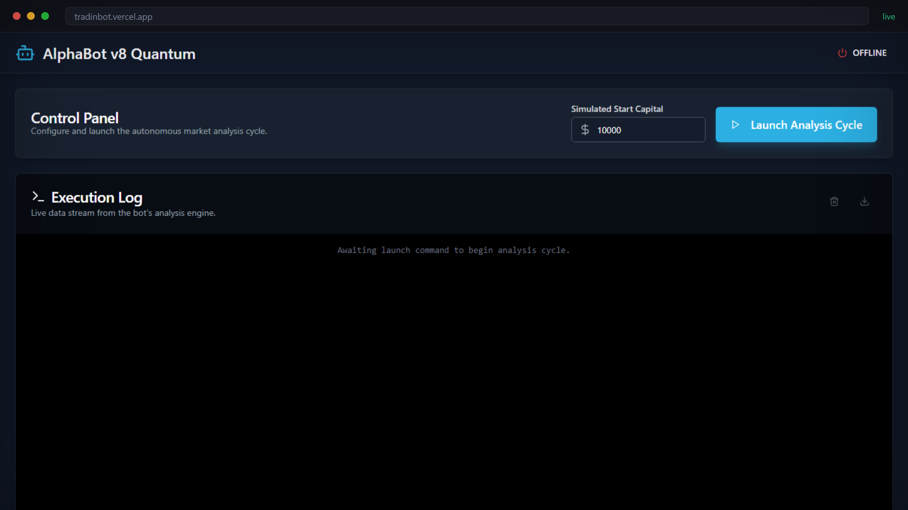</a>
  <b>AlphaBot Quantum</b> — control room for a trading agent: capital, analysis cycles, live event stream, log export. 
  React · TypeScript · Firebase 
  <a href="https://tradinbot.vercel.app"><b>Live</b></a> · <a href="https://github.com/Adis773/Tradinbot">Code</a>
</td>
<td width="50%" valign="top">
  <a href="https://vilis.vercel.app">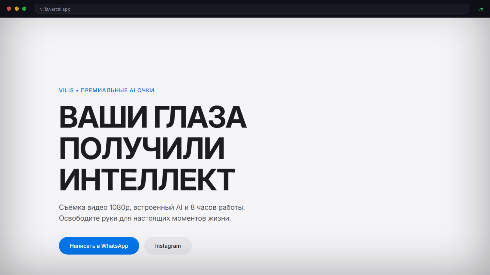</a>
  <b>VILIS</b> — launch site for premium AI glasses: 1080p capture, 8 hours of battery, built-in assistant. 
  Brand site · conversion · motion 
  <a href="https://vilis.vercel.app"><b>Live</b></a>
</td>
</tr>
<tr>
<td width="50%" valign="top">
  <a href="https://fg-self.vercel.app">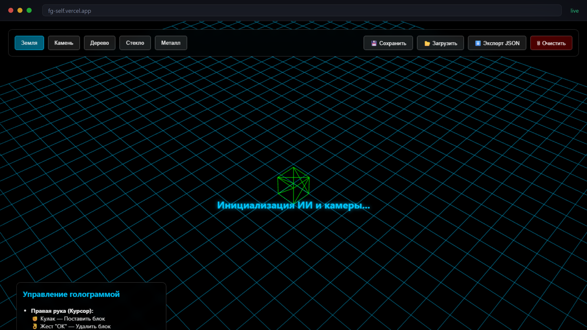</a>
  <b>AR 3D Builder</b> — hand-tracked AR editor: pinch to place blocks, gesture to delete, scene export to JSON. 
  WebXR · MediaPipe · Three.js 
  <a href="https://fg-self.vercel.app"><b>Live</b></a>
</td>
<td width="50%" valign="top">
  <a href="https://abebabank.vercel.app">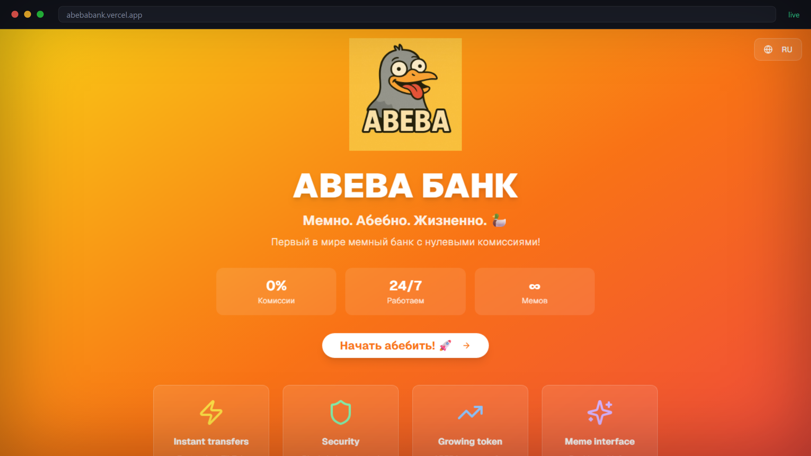</a>
  <b>ABEBA Bank</b> — zero-fee meme bank: a product experiment in brand voice, virality and conversion. 
  React · landing · Web3 
  <a href="https://abebabank.vercel.app"><b>Live</b></a> · <a href="https://github.com/Adis773/Abeba-bank-">Code</a>
</td>
</tr>
<tr>
<td width="50%" valign="top">
  <a href="https://v0-easgikcabinet-l5.vercel.app">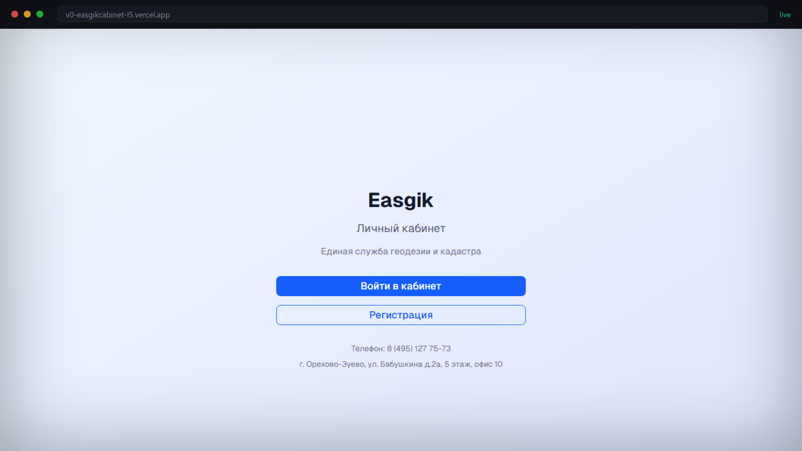</a>
  <b>Easgik</b> — customer portal for a land-survey and cadastre service: requests, documents, account area. 
  Commercial client · Next.js · Postgres 
  <a href="https://v0-easgikcabinet-l5.vercel.app"><b>Live</b></a>
</td>
<td width="50%" valign="top">
  <a href="https://barber2-eight.vercel.app">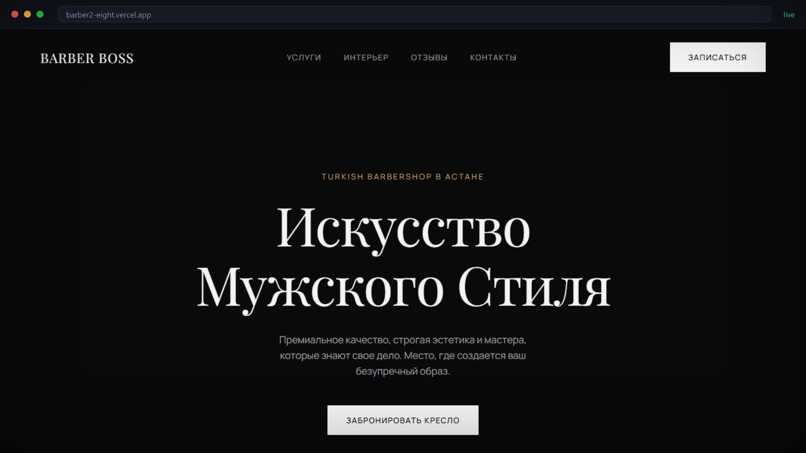</a>
  <b>Barber Boss</b> — premium barbershop in Astana: services, interior, booking flow, Telegram notifications. 
  Client site · booking · brand 
  <a href="https://barber2-eight.vercel.app"><b>Live</b></a>
</td>
</tr>
<tr>
<td width="50%" valign="top">
  <a href="https://github.com/Adis773/GameViki">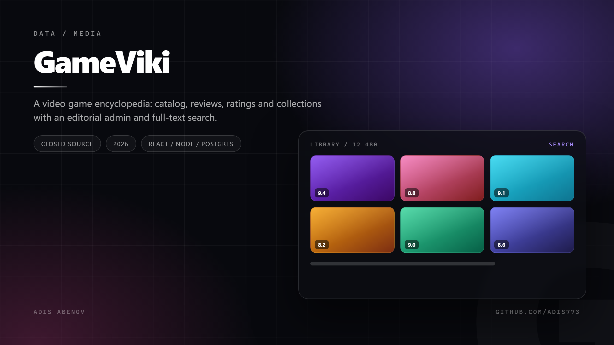</a>
  <b>GameViki</b> — video game encyclopedia: catalog, reviews, ratings, collections, editorial admin. 
  React · Node · Postgres · Redis 
  Closed source · private beta
</td>
<td width="50%" valign="top">
  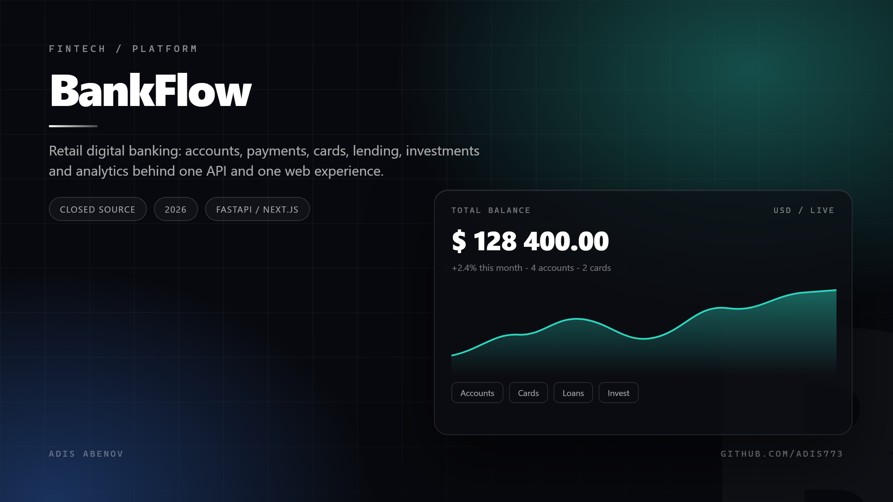
  <b>BankFlow</b> — retail digital banking: accounts, payments, cards, lending, investments, analytics. 
  FastAPI · Next.js · Kubernetes 
  Closed source · commercial
</td>
</tr>
</table>

---

## Also shipped

| Product | What it is | Link |
| :-- | :-- | :-- |
| **AInvest Terminal** | Investment terminal: portfolio, daily yield, auto-invest 10% into stocks, insights feed | [Live](https://assistent-nine.vercel.app) |
| **SmartLearnix** | AI learning platform: personal tracks, gamification, analytics | [Code](https://github.com/Adis773/SmartLearnix) |
| **TgClone** | Messenger client on React: chats, media, realtime updates | [Code](https://github.com/Adis773/Tgclone) |
| **freeGPT** | Zero-setup interface to language models | [Code](https://github.com/Adis773/freeGPT) |
| **AirOS** | Browser "operating system": windows, files, apps in a tab | [Code](https://github.com/Adis773/AirOs) |
| **CryptoMain** | Crypto portfolio tracker with auth and live rates | [Live](https://cryptomain.vercel.app) |
| **Stranger Things Shop** | Fandom merch store: catalog, cart, checkout | [Live](https://strangerthings-shop.vercel.app) |
| **Alpha Barbershop** | Second barbershop brand site with online booking | [Live](https://barber-delta-five.vercel.app) |

---

## About closed source

Six products run with private repositories — **NeuroHub**, **BankFlow**, **GameViki**, **AInvest**, plus two client systems under NDA. That's a normal part of commercial work: the product is public, the code is the client's asset.

If you need to see engineering depth rather than a landing page, I'm happy to walk through architecture, data models and trade-offs on a call — or show the open-source ones above, which are real and complete.

---

## Stack

  
  
  
  
  
  
  
  
  
  
  

I also handle everything around the code: product decisions, interface design, copy, analytics, deployment and production support.

---

## How I work

| Step | What happens |
| :--: | :-- |
| **01** | I turn the task into a user journey: who, why, what the outcome must be |
| **02** | I build the skeleton: data model, API, key screens — validated on real data, not mockups |
| **03** | I ship it: tests on critical paths, logs, metrics, error handling, deploy |
| **04** | I stay after release: iterations, handover of code and documentation |

---

### Have something that should become a working product?

Write to me — you'll get a solution, not an hourly-rate quote.

Open to ambitious projects · 2026

