

  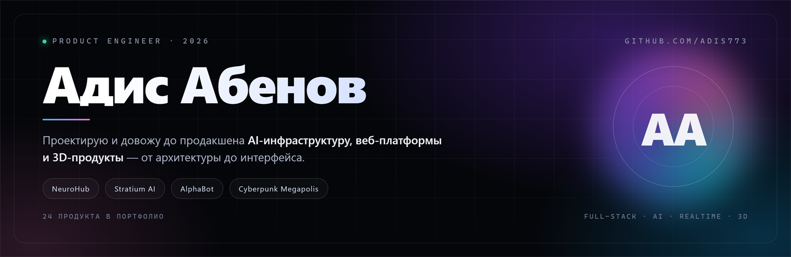

  <a href="README.md">EN</a> · <b>RU</b>

  
  
  
  

<h3 align="center">Строю продукты целиком: архитектура, бэкенд, интерфейс, инференс, деплой</h3>

<em>AI-инфраструктура · веб-платформы · realtime и 3D · 30+ запусков</em>

---

## Привет, я Адис

Меня зовут **Абенов Адис**, я product-инженер. Беру идею и довожу до состояния «работает у реальных людей»: проектирую архитектуру, пишу бэкенд и фронтенд, подключаю инференс моделей, платежи и мониторинг, потом поддерживаю в проде.

**30+ запущенных продуктов за два года** — AI-маркетплейс с оплатой по токенам, автономный агент для Windows, 3D-игра в браузере, AR-инструмент, банковская платформа, клиентские кабинеты и брендовые сайты. Часть кода закрыта NDA или коммерческой тайной: там я показываю продукт и объясняю инженерные решения, а не исходники.

> **Принцип:** сначала работающий сценарий для пользователя, потом красивая архитектура. Продукт без пользователя — это папка с файлами.

  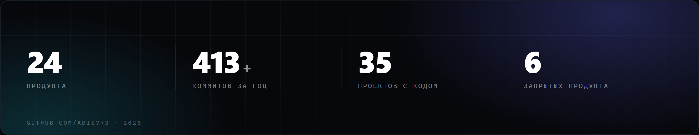

  <a href="https://adisabenov.vercel.app"><b>→ Сайт-портфолио</b></a>

---

## Избранное

### NeuroHub — инфраструктура AI-моделей

  <a href="https://novastep.tech">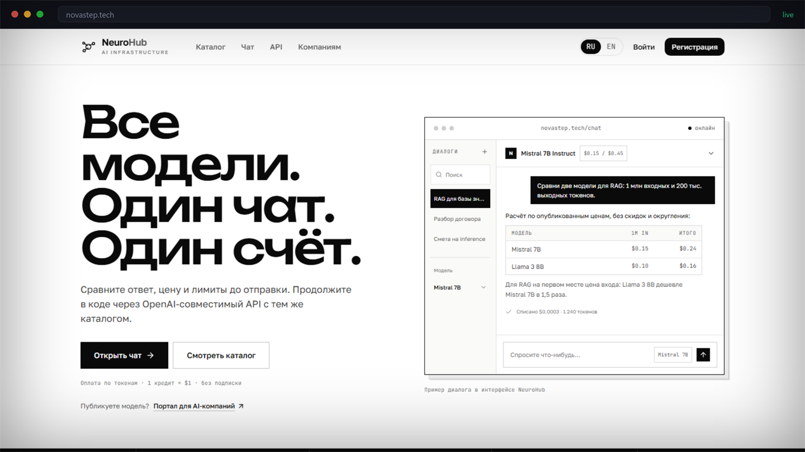</a>

Маркетплейс, где авторы загружают веса моделей, а инференс идёт на собственных GPU: каталог с ценами за миллион токенов, веб-чат с оплатой по факту, OpenAI-совместимый API и единый счёт на все модели. Биллинг, оркестрация инференса, стриминг ответов, мультиарендность — всё с нуля.

**Роль:** архитектура, бэкенд, фронтенд, инфраструктура
**Статус:** работает, код закрыт — демо по запросу

  
  

### Stratium AI — автономный агент для Windows

  <a href="https://stratium-ai-landing.vercel.app">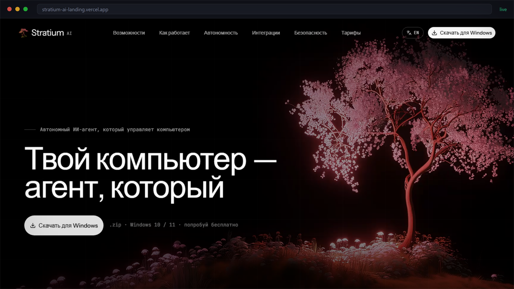</a>

Агент, который управляет компьютером: ставит задачи, работает с приложениями и файлами, держит контекст между сессиями и живёт автономно до 10 дней. Сделал продукт целиком — позиционирование, лендинг, дизайн-систему, тексты, интерактив и сборку под Windows.

**Стек:** TypeScript, React, Vite, собственные анимации на CSS/Canvas
**Сложное:** объяснить «агента на компьютере» без магии — через сценарии, а не списки фич

  
  
  

### Cyberpunk Megapolis — 3D-игра в браузере

  <a href="https://cyberpunk-megapolis.vercel.app">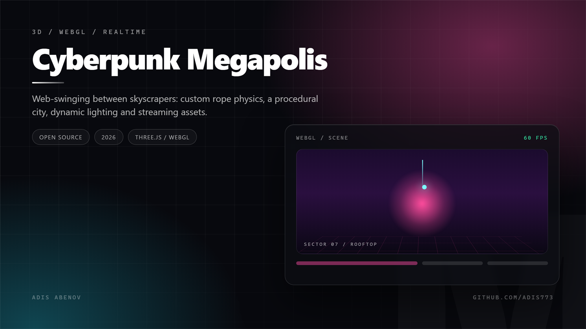</a>

Полёт на паутине между небоскрёбами: собственная физика тросов, процедурная застройка, динамическое освещение и потоковая подгрузка моделей и текстур. Отдельная гордость — пайплайн ассетов: PBR-персонаж с нормалями и металличностью, который не убивает производительность.

**Стек:** JavaScript, Three.js/WebGL, GLSL-шейдеры, свой загрузчик ассетов
**Сложное:** удержать 60 FPS на слабых ноутбуках — бюджет полигонов, батчинг, ленивая загрузка секторов

  
  
  

---

## Ещё запуски

<table>
<tr>
<td width="50%" valign="top">
  <a href="https://tradinbot.vercel.app">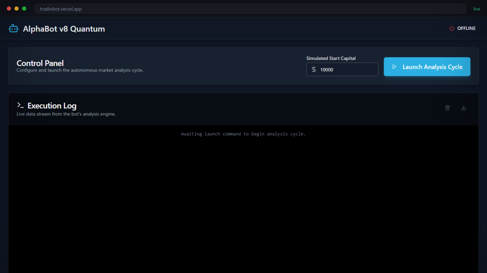</a>
  <b>AlphaBot Quantum</b> — пульт трейдинг-агента: капитал, циклы анализа, живой поток событий, экспорт логов. 
  React · TypeScript · Firebase 
  <a href="https://tradinbot.vercel.app"><b>Live</b></a> · <a href="https://github.com/Adis773/Tradinbot">Код</a>
</td>
<td width="50%" valign="top">
  <a href="https://vilis.vercel.app">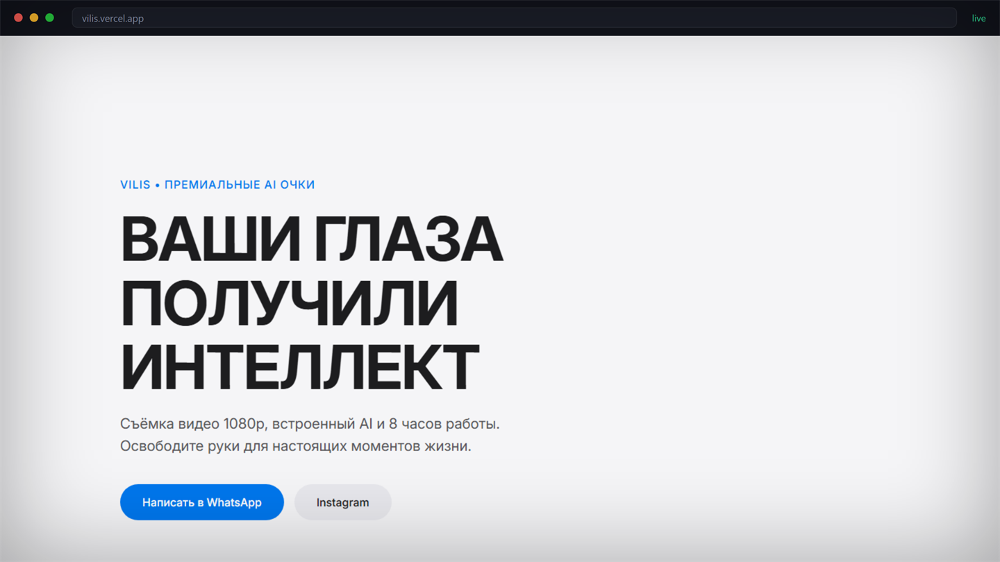</a>
  <b>VILIS</b> — запуск премиальных AI-очков: съёмка 1080p, 8 часов работы, встроенный ассистент. 
  Бренд-сайт · конверсия · анимация 
  <a href="https://vilis.vercel.app"><b>Live</b></a>
</td>
</tr>
<tr>
<td width="50%" valign="top">
  <a href="https://fg-self.vercel.app">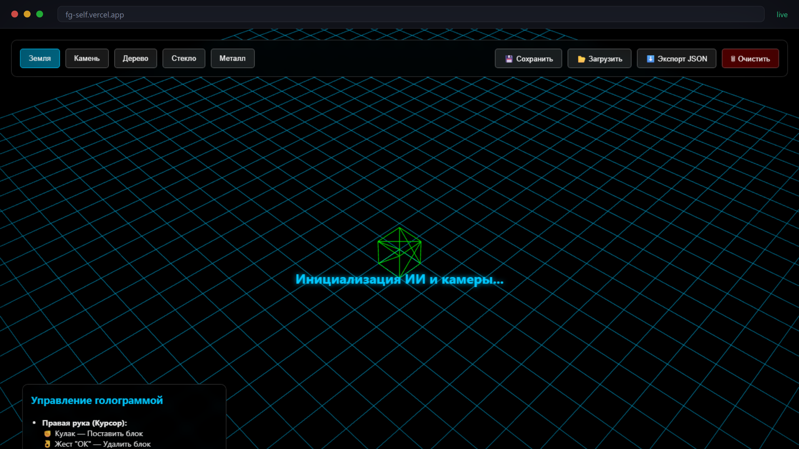</a>
  <b>AR 3D Builder</b> — AR-редактор с трекингом рук: жест ставит блок, жест удаляет, сцена выгружается в JSON. 
  WebXR · MediaPipe · Three.js 
  <a href="https://fg-self.vercel.app"><b>Live</b></a>
</td>
<td width="50%" valign="top">
  <a href="https://abebabank.vercel.app">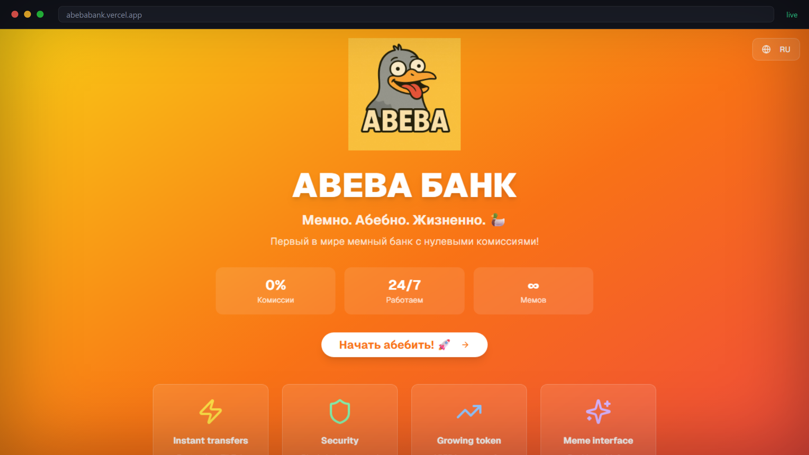</a>
  <b>ABEBA Bank</b> — мемный банк с нулевыми комиссиями: эксперимент с брендом, виральностью и конверсией. 
  React · лендинг · Web3 
  <a href="https://abebabank.vercel.app"><b>Live</b></a> · <a href="https://github.com/Adis773/Abeba-bank-">Код</a>
</td>
</tr>
<tr>
<td width="50%" valign="top">
  <a href="https://v0-easgikcabinet-l5.vercel.app">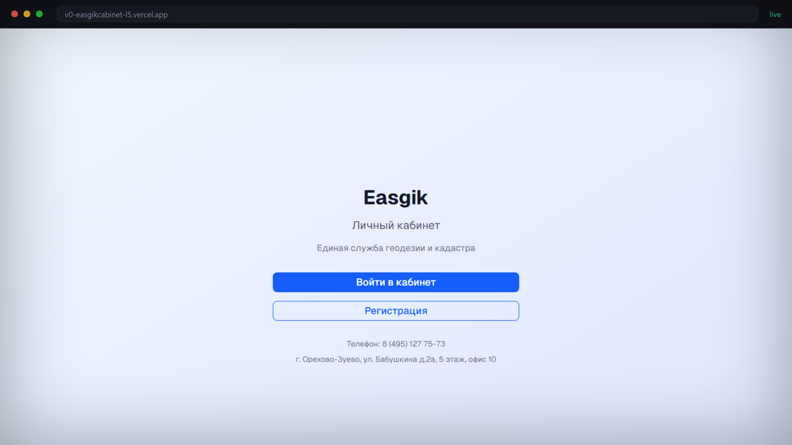</a>
  <b>Easgik</b> — кабинет службы геодезии и кадастра: заявки, документы, личный кабинет. 
  Коммерческий клиент · Next.js · Postgres 
  <a href="https://v0-easgikcabinet-l5.vercel.app"><b>Live</b></a>
</td>
<td width="50%" valign="top">
  <a href="https://barber2-eight.vercel.app">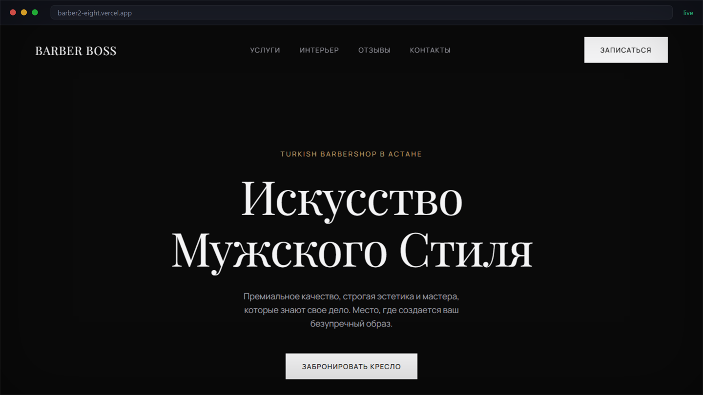</a>
  <b>Barber Boss</b> — премиальный барбершоп в Астане: услуги, интерьер, запись, уведомления в Telegram. 
  Клиентский сайт · запись · бренд 
  <a href="https://barber2-eight.vercel.app"><b>Live</b></a>
</td>
</tr>
<tr>
<td width="50%" valign="top">
  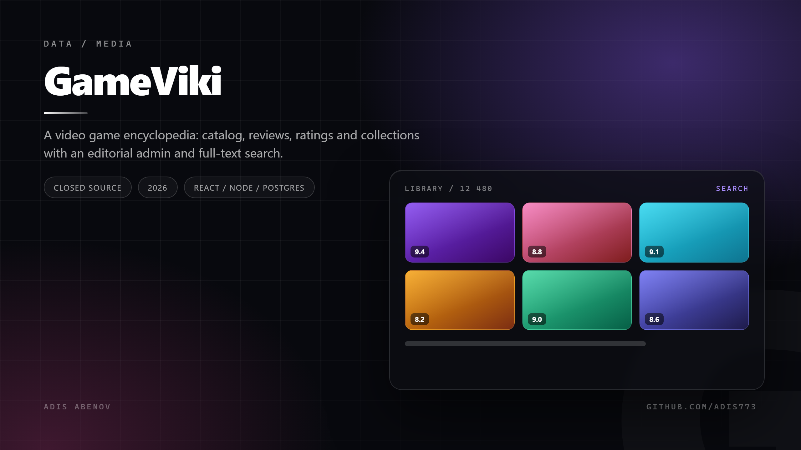
  <b>GameViki</b> — энциклопедия видеоигр: каталог, рецензии, оценки, подборки, админка редакции. 
  React · Node · Postgres · Redis 
  Код закрыт · приватная бета
</td>
<td width="50%" valign="top">
  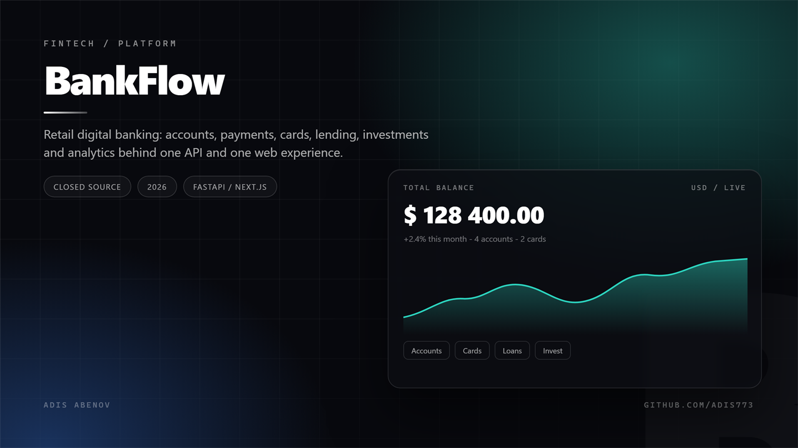
  <b>BankFlow</b> — розничный цифровой банк: счета, платежи, карты, кредиты, инвестиции, аналитика. 
  FastAPI · Next.js · Kubernetes 
  Код закрыт · коммерческая разработка
</td>
</tr>
</table>

---

## Также в портфолио

| Продукт | Что это | Ссылка |
| :-- | :-- | :-- |
| **AInvest Terminal** | Инвестиционный терминал: портфель, доход за день, автоинвест 10% в акции, лента идей | [Live](https://assistent-nine.vercel.app) |
| **SmartLearnix** | AI-платформа обучения: персональные треки, геймификация, аналитика | [Код](https://github.com/Adis773/SmartLearnix) |
| **TgClone** | Клиент мессенджера на React: чаты, медиа, realtime | [Код](https://github.com/Adis773/Tgclone) |
| **freeGPT** | Интерфейс доступа к моделям без настройки | [Код](https://github.com/Adis773/freeGPT) |
| **AirOS** | «Операционная система» в браузере: окна, файлы, приложения | [Код](https://github.com/Adis773/AirOs) |
| **CryptoMain** | Крипто-портфель с авторизацией и живыми курсами | [Live](https://cryptomain.vercel.app) |
| **Stranger Things Shop** | Магазин мерча по франшизе: каталог, корзина, оформление | [Live](https://strangerthings-shop.vercel.app) |
| **Alpha Barbershop** | Второй бренд барбершопа с онлайн-записью | [Live](https://barber-delta-five.vercel.app) |

---

## Про закрытый код

Шесть продуктов работают с приватными репозиториями — **NeuroHub**, **BankFlow**, **GameViki**, **AInvest** и две клиентские системы под NDA. Это нормальная часть коммерческой разработки: продукт публичен, код — актив клиента.

Если нужно увидеть инженерную глубину, а не лендинг, — разберу архитектуру, модели данных и компромиссы на созвоне или покажу открытые проекты выше: они настоящие и полностью рабочие.

---

## Стек

  
  
  
  
  
  
  
  
  
  
  

Умею и то, что вокруг кода: продуктовые решения, дизайн интерфейсов, тексты, аналитика, деплой и поддержка в проде.

---

## Как я работаю

| Шаг | Что происходит |
| :--: | :-- |
| **01** | Разбираю задачу до пользовательского сценария: кто, зачем, что должно получиться на выходе |
| **02** | Собираю каркас: схема данных, API, ключевые экраны — на реальных данных, а не на мокапах |
| **03** | Довожу до продакшена: тесты на критичные пути, логи, метрики, обработка ошибок, деплой |
| **04** | Остаюсь после релиза: правки, развитие, передача кода и документации |

---

### Есть задача, которую нужно довести до работающего продукта?

Пишите — отвечу решением, а не прайсом за человеко-часы.

Открыт к интересным проектам · 2026

